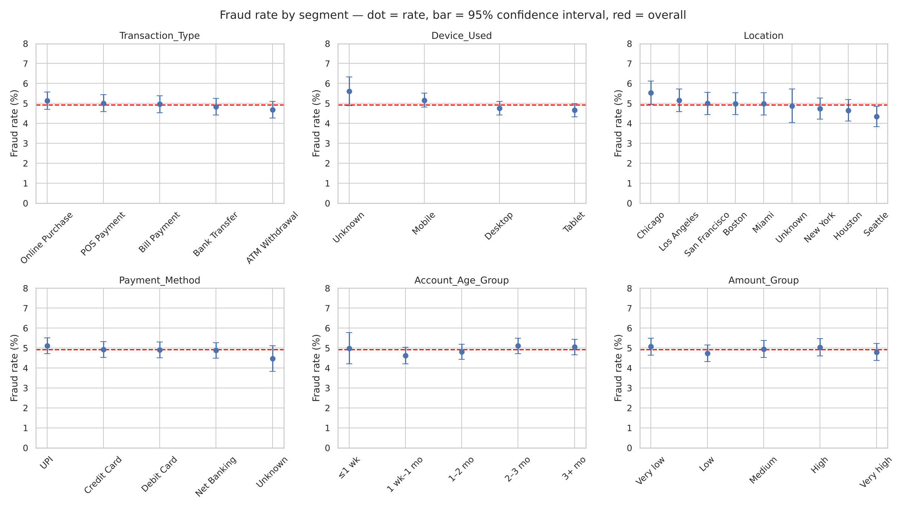

# Fraud Analysis — Summary for Management

**Question:** Can we identify fraud from the transaction details we currently collect?

**Answer:** **No.** Fraud happens at about the same rate (≈5%) in every group we examined. The data we collect today does not show where fraud comes from.

---

## What we looked at

- **50,000 transactions** (after removing 1,000 duplicates), of which **2,460 (4.92%) were fraud**
- Every available detail: transaction type, amount, time of day, device, city, payment method, account age, recent activity, and past fraud history

## What we found

| Detail | Highest fraud rate | Lowest fraud rate | Meaningful? |
|---|---|---|---|
| City | Chicago 5.5% | Seattle 4.3% | **No.** A gap this size happens by chance |
| Device | Unknown 5.6% | Tablet 4.7% | **No.** Weak, not confirmed |
| Payment method | UPI 5.1% | Net Banking 4.9% | No |
| Transaction type | Online 5.1% | ATM 4.7% | No |
| Amount, account age, time of day | all ≈ 4.5–5.5% | | No |
| Past fraud on the account | 0 past frauds: 4.7% | 4 past frauds: 4.8% | **No.** Surprisingly, no effect |

*Each dot is a group's fraud rate and the bar shows its margin of error. Almost every bar crosses the red company-wide average.*

## Could a computer model find it?

**No.** We trained two prediction models on all the details at once. Both were no better than random guessing, which means fraud isn't hiding in *combinations* of details either. The pattern of the data suggests fraud labels may have been recorded or generated independently of the transaction details, which is worth checking with the data owner.

## Why we should not act on "Chicago has the most fraud"

Chicago is the highest of 8 cities, but **one city will always be the highest**, even when fraud is completely random. We tested this with a simulation: picking the top city and calling it a hotspot is wrong about **1 time in 4**. When all cities are compared fairly, the difference is not significant.

## Recommendations

1. **Don't add fraud checks based on city, device, payment method or amount.** They would add cost and customer friction without catching more fraud.
2. **Start collecting stronger fraud signals:** device fingerprint, IP address and location mismatch, merchant type, time since the customer's last transaction, and spending compared with each customer's usual pattern.
3. **Watch transactions with no device recorded.** They show slightly more fraud (5.6% vs 4.9%). That isn't proven yet, but it's worth tracking.
4. **Fix data quality at the source.** About 5% of records have missing fields, 2% were duplicated, and some amounts look 10× too large.

## Data quality note

The raw data needed cleaning before analysis: 1,000 duplicate records, 3,060 placeholder values ("Unknown Device", "Invalid Method"), and about 5% missing values in 5 fields. All cleaning steps are documented in the analysis notebook.
