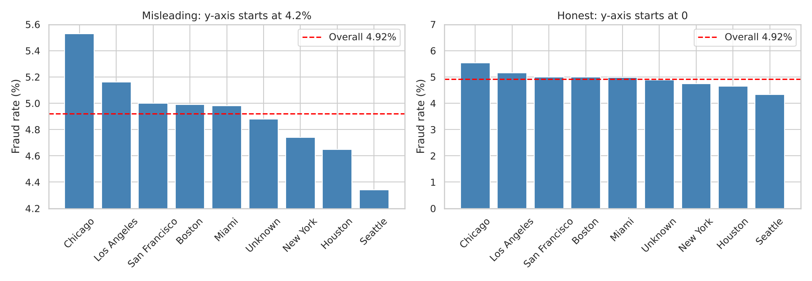
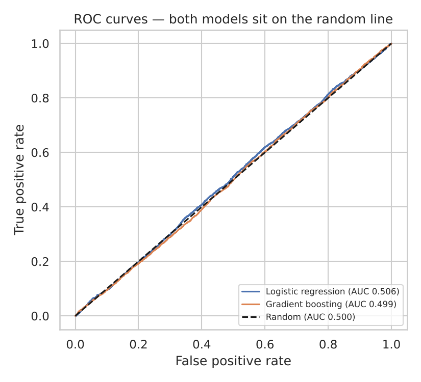
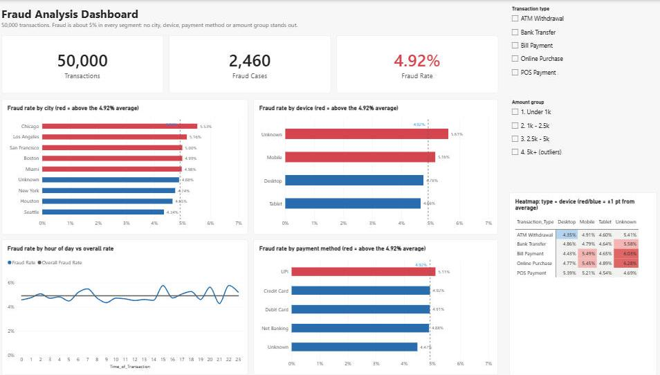
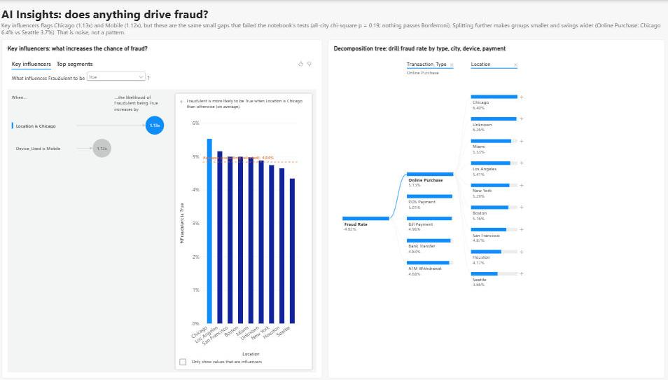

# Fraud Detection — Exploratory Data Analysis

An end-to-end data analysis of 51,000 financial transactions to find out **what distinguishes fraudulent transactions from legitimate ones**.

**Main result:** after cleaning and statistical testing, **no attribute in this dataset meaningfully predicts fraud**. Fraud occurs at about 5% across every device, city, payment method, amount and account age. The project shows how to reach that conclusion rigorously and how to avoid the false "discoveries" that random noise produces.


---

## Dataset

| | |
|---|---|
| Rows / columns | 51,000 raw → **50,000 after cleaning** / 12 |
| Target | `Fraudulent` (1 = fraud), **4.92%** fraud rate |
| Features | amount, transaction type, hour, device, location, payment method, previous frauds, account age (days), transactions in last 24h, user ID |

## Tools

Python · pandas · NumPy · Matplotlib · seaborn · SciPy · scikit-learn · Jupyter · Power BI (Power Query, DAX)

## Project steps

| Step | What I did | Key techniques |
|---|---|---|
| 1. Overview | Shape, types, missing values, class balance | `info`, `describe`, `value_counts` |
| 2. Data quality audit | Found duplicates, disguised missing values, outliers | IQR outlier rule, duplicate analysis |
| 3. Cleaning | De-duplicated, standardized missing values, imputed, fixed types, validated | `drop_duplicates`, group-wise median imputation, `assert` checks |
| 4. EDA | Fraud rate for every segment vs the overall rate | `groupby`, binning (`cut`/`qcut`), reusable functions |
| 5. Deep-dive | Two-way combinations + a **permutation (shuffle) test** built from scratch | pivot tables, simulation |
| 6. Visualization | Honest vs misleading charts, confidence intervals, distributions | Matplotlib, seaborn |
| 7. Statistics | Chi-square, t-test, Mann-Whitney U, two-proportion z-test, effect sizes, Bonferroni correction | SciPy |
| 8. Simulation | Proved how cherry-picking inflates false positives | Monte Carlo simulation |
| 9. Baseline models | Tested whether *combinations* of columns predict fraud | Logistic regression, gradient boosting, stratified 5-fold CV, ROC-AUC / PR-AUC, shuffled-label control |
| 10. Conclusion | Final answer, data-generation diagnosis, recommendations | |

## Data quality issues found and fixed

| Issue | Rows | Fix |
|---|---|---|
| Duplicate transaction IDs (881 identical + 119 differing only by a blank/placeholder) | 1,000 | Kept the most complete copy per ID |
| Disguised missing values: `"Unknown Device"`, `"Invalid Method"` | 1,530 + 1,530 | Converted to missing |
| Missing values in 5 columns | ~5% each | Categories → `"Unknown"`; amount → median per transaction type (+ flag column); hour → left blank to avoid a fake noon spike |
| Amount outliers (> 7,557, IQR fence on cleaned, non-imputed amounts) | 500 | **Kept**, because fraud is often the outlier |

## Key findings

1. **No single attribute separates fraud.** Every segment's fraud rate is within ~1 percentage point of 4.92%.
2. **Fraud and legitimate transactions look identical on the numbers.** Using only real (non-imputed) amounts, the median is 2,506 vs 2,524 (Mann-Whitney p = 0.66), median account age is 62 vs 60 days, and every correlation with fraud is between −0.004 and +0.006.
3. **"Previous fraudulent transactions" does not predict fraud.** Accounts with 0 previous frauds have a 4.70% fraud rate; accounts with 4 have 4.80%.
4. **Formal tests confirm it.** Chi-square p-values range from 0.03 to 0.77, and **none pass the Bonferroni threshold (0.0063)**. Effect sizes (Cramér's V) are around 0.01.
5. **Weak hint worth monitoring:** transactions with **no device recorded** have 5.6% fraud vs 4.9% (p ≈ 0.03, not significant after correction).
6. **Per-user fraud is chance too.** The worst users have 5 frauds. A simulation where every transaction has the same 4.92% fraud chance produces 5 or more in 83% of runs.
7. **Models can't beat a coin flip.** Logistic regression ROC-AUC 0.506 and gradient boosting 0.499, the same as a model trained on shuffled labels (0.496). Fraud isn't hiding in combinations of columns either.
8. **The dataset is very likely synthetic.** Past fraud has no link to current fraud, missing values are ~5% in every affected column, and group sizes are nearly equal. The labels behave like independent coin flips.
9. **The cherry-picking trap:** "Chicago vs rest" gives p = 0.02, but Chicago was chosen *because* it was highest. A simulation showed that this approach raises false alarms **22.6%** of the time instead of 5%. Testing all cities together gives p = 0.19.



*Same data, two stories: a y-axis that doesn't start at zero makes Chicago look twice as risky as Seattle.*



*Both baseline models sit on the random-guessing line.*

## Power BI dashboard

An interactive two-page dashboard built on the cleaned data (`fraud_dashboard.pbip`).



**Page 1: Overview**
- KPI cards: transactions, fraud cases, fraud rate (they match the notebook: 50,000 / 2,460 / 4.92%)
- Fraud rate by city, device and payment method, with **conditional colors** (red = above the 4.92% average) and a dashed average line. Every axis starts at 0.
- Fraud rate by hour against the overall rate, with the 2,500 rows that have no hour filtered out
- A type × device heatmap colored by the gap from average
- Slicers for transaction type and amount group, which filter the whole page



**Page 2: AI Insights**
- **Key influencers** (Power BI's built-in ML visual) flags Chicago (1.13×) and Mobile (1.12×). These are the same small gaps that failed the notebook's tests (all-city chi-square p = 0.19, nothing passes Bonferroni), so the dashboard labels them as noise. This shows why automated "insights" still need a statistical check.
- **Decomposition tree**: drill fraud rate by type → city → device → payment method. Smaller groups swing further from the average (for Online Purchase: Chicago 6.4% vs Seattle 3.7%).

**Built with**
- **Power Query (M):** typed columns and two group columns (`Account_Age_Group`, `Amount_Group`)
- **DAX measures:** `Transactions`, `Fraud Cases`, `Fraud Rate` (`DIVIDE`), `Overall Fraud Rate` (`CALCULATE` + `ALL`), `Gap vs Overall (pts)`, and two color measures used for conditional formatting
- **PBIP / PBIR format:** the report and model are saved as text files, so they are version-controlled in Git

## Recommendations

- **Don't build fraud rules on these attributes.** City-, device- or amount-based rules would add cost without catching more fraud.
- **Collect stronger signals:** device fingerprint, IP address and geolocation mismatch, merchant category, time since the previous transaction, and spending relative to each user's normal behavior.
- **Monitor transactions with missing device data** to see whether the weak signal persists.
- **Check the 40k–50k amount cluster with the data owner.** It may be a ×10 data-entry error.

## What I learned

- Data cleaning decisions (which duplicate to keep, how to impute) must be checked against the data, not assumed.
- With imbalanced classes, compare **rates**, not counts.
- A model is a strong final check: AUC ≈ 0.50 plus a shuffled-label control is clear proof of "no signal".
- A small p-value after looking at the data is not evidence. Multiple comparisons and cherry-picking create false discoveries.
- **"No pattern found" is a valid, valuable result** when it is shown honestly.

## How to run

```bash
pip install -r requirements.txt
jupyter notebook "Fraud Detection Dataset.ipynb"
```

Keep `Fraud Detection Dataset.csv` next to the notebook and run all cells from top to bottom (about 1 minute). The notebook writes `fraud_clean.csv` and saves every chart to `figures/`.

**Power BI:** run the notebook first (it creates `fraud_clean.csv`), then open `fraud_dashboard.pbip` in Power BI Desktop. If your folder is not `D:\Work\Fraud Detection Dataset`, update the file path in **Transform data → Data source settings**.

## Files

| File | Description |
|---|---|
| `Fraud Detection Dataset.ipynb` | Full analysis notebook with findings after each step |
| `Fraud Detection Dataset.csv` | Raw data |
| `fraud_clean.csv` | Cleaned data (generated) |
| `figures/` | All charts (generated) |
| `MANAGER_SUMMARY.md` | One-page summary for non-technical readers |
| `fraud_dashboard.pbip` + `fraud_dashboard.Report/` + `fraud_dashboard.SemanticModel/` | Power BI dashboard (project format) |
